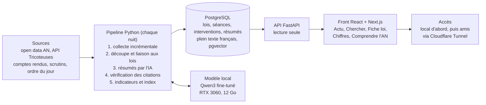

# Cadrage – Mot pour mot

Oct 27, 2026 · @Augustin Viemont

## Vision

Comprendre en 2 minutes ce que chaque groupe politique pense d'une loi, sans suivre les débats de l'Assemblée.

- **Public** : citoyens curieux et militants, qui n'ont pas le temps de regarder les séances.
- **Promesse** : un fil des lois en cours résumées par groupe, chaque position appuyée par une citation sourcée, et une recherche pour retrouver quand une loi a été débattue et qui a dit quoi.
- **Nature du projet** : open source, d'abord pour soi, partageable avec des amis puis plus largement.

## Contexte et positionnement

Les outils existants sont rétrospectifs ou bruts ; aucun ne résume les positions des groupes texte par texte, en continu.

| Outil | Ce qu'il fait | Ce qui manque |
| --- | --- | --- |
| [Datan](https://datan.fr/) | Votes des députés et des groupes, cohésion, statistiques | Une sélection de votes seulement, après le vote, pas de résumé des arguments |
| [NosDéputés.fr](https://github.com/regardscitoyens/nosdeputes.fr/blob/master/doc/api.md) | Activité de chaque député, API ouverte | Vue par député, pas par texte |
| La Fabrique de la Loi | Évolution d'un texte article par article | Montre le texte, pas qui défend quoi |
| [Tricoteuses](https://www.tricoteuses.fr/) | Données AN enrichies (textes, temps réel) via API | Données brutes, pas d'interface grand public |
| Open Hémicycle | Votes et activité de chaque député, indice de cohérence prévu (preuve de concept) | Vue par député, pas de résumé des positions par loi ni de recherche dans les débats |

**Différenciation** : un résumé des arguments par groupe, mis à jour tout au long du parcours du texte, chaque argument relié à une citation et à sa source.

## Périmètre fonctionnel V1 (Assemblée nationale)

Quatre onglets et une page centrale, la fiche loi, vers laquelle mènent Actu et Chercher. Parcours type : **Actu ou Chercher → Fiche loi → Séance**.

1. **Actu** : l'agenda de la semaine en tête, puis les lois en cours ou récemment débattues, triées par importance (amendements, interventions, scrutins, récence) et par date, avec un filtre en cours / adoptées / rejetées. Chaque carte montre le statut, le titre en langage clair, un résumé d'une phrase et le décompte des positions.
2. **Chercher** : une seule barre de recherche, *trois filtres de résultats : Tout, Lois (par nom ou mots-clés) et Propo**s* (un propos, un mot, un orateur), filtrables par date, groupe et député.
3. **Fiche loi** (page d'arrivée), en trois onglets Résumé, Positions et Débats :
   - synthèse globale : de quoi parle le texte, points d'accord et de désaccord ;
   - une section par groupe : position, 2 à 4 arguments, chacun appuyé par une citation avec lien vers le compte rendu ;
   - frise des débats : chaque séance publique, datée (réunions de commission en V1.1) ;
   - détail d'une séance : les interventions dans l'ordre, avec orateur et groupe, filtrables, avec recherche dans le texte ;
   - hémicycle du vote quand il y a eu un scrutin.
4. **Chiffres** : en V1, composition de l'hémicycle et participation aux scrutins par groupe (avec son explication) ; en V1.1, cohésion de vote, proximité entre groupes, amendements déposés et adoptés, temps de parole.
5. **Comprendre l'AN** : guides sur qui fait quoi, le parcours d'une loi, les types de vote, le 49.3, les motions de censure. Ils servent aussi de glossaire depuis les fiches.

## Principes éditoriaux

La crédibilité de l'appli repose sur sa neutralité ; chaque règle ci-dessous sert à la rendre vérifiable.

- **Chaque argument est sourcé** : pas d'argument affiché sans citation d'un député et lien vers le compte rendu officiel.
- **Les groupes parlent dans leurs termes** : « selon le groupe X… », jamais de verdict de l'appli sur qui a raison.
- **Traitement identique** : même nombre d'arguments maximum, même format et même ordre pour tous les groupes.
- **Citations vérifiées automatiquement** : la citation affichée doit exister mot pour mot dans le compte rendu, sinon elle est rejetée.
- **Les propos bruts restent accessibles** : la recherche et le détail des séances montrent les vraies interventions, sans IA, pour vérifier chaque résumé.
- **Chiffres expliqués** : chaque indicateur affiche sa définition et ses limites (la participation aux scrutins ne mesure pas la présence).
- **Transparence** : mention « résumé généré par IA » et lien vers la méthode et le code source.
- **Silence explicite** : un groupe qui ne s'est pas exprimé est affiché comme tel, sans position déduite.

## Fonctionnalités par version

Les écrans sont enrichis version par version. L'appli tourne d'abord en local sur le PC (base, API, front), puis peut être ouverte aux amis.

**Exclu** : appli mobile native, fiches individuelles des 577 députés, prédiction de vote, chatbot en direct. Les comptes utilisateurs et les notifications deviennent possibles grâce au serveur, mais ne sont pas prévus avant la V2.

### V1 : socle crédible

| Fonctionnalité | Besoin technique |
| --- | --- |
| Recherche de lois | Index plein texte PostgreSQL (configuration française) |
| Recherche dans les débats (qui a dit quoi, quand) | Comptes rendus découpés en interventions (orateur, groupe, date, séance, texte, lien source) |
| Frise des débats d'une loi | Liaison séances publiques ↔ dossier législatif par le numéro du texte discuté (commissions en V1.1) |
| Hémicycle du vote et dissidents sur la fiche | Scrutins nominatifs, rendu SVG, calcul sans IA |
| Indice de confiance par argument | Résultat de la vérification des citations stocké en base |
| Guides de base « Comprendre l'AN » | Pages rédigées à la main, liens depuis les termes techniques des fiches |
| Agenda de la semaine | Ordre du jour de l'AN (open data), mis à jour chaque nuit |
| Mobile d'abord, mode sombre, couleurs officielles des groupes (open data AN) | Design system : palette, thèmes clair et sombre |
| Signaler une erreur | Lien vers une issue GitHub pré-remplie |
| Page « Méthode » et charte de neutralité | Résultats d'évaluation publiés ; charte réutilisée dans les prompts |
| CI et tests | pytest (parseurs, API, schéma), GitHub Actions |
| Suivi du run de nuit | Logs, statut affiché dans l'appli, alerte mail ou Discord en cas d'échec |
| Mentions légales, RGPD, licences, avertissement IA | Pages dédiées, attribution des sources sur chaque fiche |

### V1.1 : approfondir

| Fonctionnalité | Besoin technique |
| --- | --- |
| Écran Chiffres complet (la composition et la participation sont en V1) | Agrégats calculés chaque nuit (participation, cohésion, proximité, amendements, temps de parole), graphiques côté front |
| Recherche sémantique | Embeddings calculés sur la RTX 3060, stockés avec pgvector |
| « Ce que ça change » | Textes via Tricoteuses, 2e tâche du modèle avec son évaluation |
| Amendements clés | Open data des amendements, score de sélection, résumé des exposés sommaires |
| Comparateur de groupes | Vue côté front, aucune donnée en plus |
| Motions de censure | Scrutins et comptes rendus déjà collectés, page dédiée |
| Récap hebdo | Page « cette semaine », flux RSS, newsletter |
| Appli installable (PWA) | Manifest et service worker |
| Historique des fiches | Versions des résumés conservées en base |
| Open data des résumés | Export via l'API, schéma documenté, licence |
| Détection de biais | Script d'audit : longueur, ton et vocabulaire par groupe |
| Statistiques sans cookies | Outil respectueux de la vie privée, sans bannière |
| Guide de contribution | README, CONTRIBUTING, issues étiquetées |
| Comptes rendus de commission | HTML et PDF seulement à l'Assemblée : extraction via l'outil Tricoteuses ou un analyseur HTML, puis même découpage en interventions (décidé le 29 octobre) |

### V2 : contexte et Sénat

| Fonctionnalité | Besoin technique |
| --- | --- |
| Sénat | Open data du Sénat, suivi de la navette, positions des groupes sénatoriaux |
| Bilan d'influence | Jointure amendements × auteurs × groupes |
| Discours vs vote | Classification de la position puis comparaison au scrutin ; relecture humaine obligatoire |
| Lobbying déclaré | Registre HATVP, rapprochement avec le dossier législatif |
| Revue de presse | Flux RSS de médias, rapprochement automatique, liens uniquement (droits d'auteur) |
| Pétitions liées | Plateforme des pétitions de l'AN, rapprochement thématique |
| Questions au gouvernement | Même pipeline, nouveau type de document |
| Évolution d'un groupe par thème | Classification thématique, agrégation historique, graphiques |
| Boucle d'amélioration du modèle | Issues signalées → exemples corrigés, réentraînement périodique |
| Publication du modèle | Hugging Face, model card, licence compatible avec Qwen et les données |

### V3 : élargir

| Fonctionnalité | Besoin technique |
| --- | --- |
| Parlement européen | Votes nominatifs, positions des délégations françaises |
| Rapports d'enquête | Documents très longs, découpage avancé, modèle plus gros |
| Comparaison entre législatures | Traitement de l'historique, correspondance des groupes renommés |

L'ordre V2 / V3 du Sénat et du Parlement européen reste interchangeable.

## Architecture technique

L'appli tourne d'abord entièrement sur le PC : le pipeline de nuit remplit une base PostgreSQL, qu'une API FastAPI sert à un front JS.

*Tout tourne sur le PC. Le pipeline est le seul composant qui écrit en base.*

Le pipeline ne traite que ce qui est nouveau depuis la veille. Pour partager l'appli sans payer, Cloudflare Tunnel expose le PC sur une adresse publique sans ouvrir de port sur la box ; l'appli n'est alors accessible que quand le PC est allumé. Si ça devient gênant, un petit VPS coûte quelques euros par mois.

| Brique | Choix proposé | Pourquoi |
| --- | --- | --- |
| Collecte et traitement | Python | Ta stack de prédilection pour la data et l'IA |
| Exécution planifiée | Planificateur de tâches Windows | Le run de nuit tourne là où est le GPU |
| Base de données | PostgreSQL (plein texte français) + pgvector | Recherche dans des centaines de milliers d'interventions ; sémantique en V1.1 |
| API | FastAPI | Python, rapide, documentation OpenAPI automatique |
| Front | React avec Next.js, qui appelle l'API | Responsive, mobile d'abord |
| Résumés | Petit modèle open-weight (Qwen3 1,7B à 4B) fine-tuné en QLoRA, quantifié et servi en local (Ollama ou llama.cpp) | 0 €, tâche étroite et répétitive |
| Entraînement | Unsloth sous WSL2, sur la RTX 3060 | Un 4B en QLoRA tient dans 12 Go de VRAM |
| Déploiement | Docker Compose (base, API, front) | Installation reproductible, migration facile vers un VPS |
| Accès externe | Cloudflare Tunnel (gratuit) | Aucun port ouvert sur la box |
| Code | Dépôt GitHub public, CI GitHub Actions | Open source, tests à chaque push |

## Entraînement et évaluation du modèle

Le modèle retenu sera celui qui obtient le meilleur score sur un jeu de test fixe, pas celui choisi a priori.

1. **Jeu de référence** : une vingtaine de textes résumés par un gros modèle open-weight, puis validés à la main. Il sert de test et ne sert jamais à l'entraînement.
2. **Données d'entraînement** : quelques centaines d'exemples (extrait de débat → résumé par groupe avec citations), générés par distillation depuis un gros modèle dont la licence autorise cet usage, avec relecture d'un échantillon.
3. **Baseline** : le petit modèle sans entraînement, avec un bon prompt.
4. **Fine-tuning QLoRA**, puis comparaison des trois sur le jeu de test.

| Métrique | Ce qu'elle vérifie |
| --- | --- |
| Citations exactes (%) | La citation existe mot pour mot dans le compte rendu |
| Couverture des groupes (%) | Chaque groupe qui s'est exprimé apparaît |
| Respect du format (%) | Le JSON produit est valide et complet |
| Neutralité (note de 1 à 5) | Note donnée par un modèle juge, contrôlée à la main sur un échantillon |
| Temps d'inférence par texte (s) | Le run de nuit reste raisonnable |

### Répartition des tâches IA

Le petit modèle local couvre le quotidien ; un modèle plus gros n'intervient que pour la distillation et quelques cas difficiles à faible volume.

| Tâche | Qui la fait | Où |
| --- | --- | --- |
| Positions, « ce que ça change », amendements, QAG, motions, thèmes | Petit modèle fine-tuné (Qwen3 1,7B à 4B) | PC, chaque nuit |
| Cohésion, dissidents, bilan d'influence | Calcul, sans IA | PC, chaque nuit |
| Discours vs vote, rapports d'enquête | Modèle MoE moyen (ex. Qwen3-30B-A3B quantifié), relecture humaine pour discours vs vote | PC, faible volume |
| Distillation (modèle professeur) | Modèle MoE moyen, ou GPU gratuits Kaggle / Colab | PC ou cloud, ponctuel |
| Jeu de référence (\~20 textes) | Gros modèle dont les conditions autorisent l'usage, puis validation manuelle | Ponctuel |

**Charge estimée** (ordres de grandeur, à mesurer au jalon 7) : environ 25 minutes une nuit normale, environ 2 heures en période budgétaire, soit 6 à 15 € d'électricité par an.

**Options de repli** : location de GPU à l'heure pour un entraînement plus gros, crédits de calcul pour projets open source une fois le projet public.

**Conséquences techniques** :

- Modèle multi-tâches : un dataset et une évaluation par tâche.
- Collecte modulaire, un module par source : open data AN, Tricoteuses, amendements, ordre du jour, HATVP, pétitions, flux presse.
- Le modèle de données (loi, séance, intervention, orateur, groupe, scrutin) est la fondation : il se conçoit avant tout le reste.

## Risques et parades

| Risque | Parade |
| --- | --- |
| Résumé IA biaisé ou erroné | Citations vérifiées mot pour mot, format identique par groupe, propos bruts accessibles via la recherche |
| Petit modèle de qualité insuffisante | Jeu de test et métriques fixes ; couche d'abstraction pour passer à un modèle plus gros si besoin |
| Comptes rendus très longs | Découper par groupe et par article avant de résumer |
| Liaison séances ↔ dossier législatif incomplète | Relier par le numéro du texte discuté (champ bibard du compte rendu), signaler les séances non rattachées |
| Indicateurs mal interprétés (ex. participation) | Définition et limites affichées à côté de chaque chiffre |
| PC exposé sur internet | Cloudflare Tunnel, API en lecture seule, aucune donnée personnelle stockée, mises à jour régulières |
| PC éteint ou en veille, ou format de l'open data qui change | Réveil planifié et rattrapage des jours manqués ; tests sur les parseurs |
| Peu de temps disponible | Pipeline automatique, V1 centrée sur Actu, Chercher et la fiche loi |
| Score « loi importante » mal calibré | Commencer simple et ajuster en comparant avec l'actualité médiatique |

## Jalons

Sans échéance fixe, au rythme de quelques heures par semaine ; chaque jalon donne quelque chose d'utilisable.

1. **Modèle de données** : schéma PostgreSQL (lois, séances, interventions, orateurs, groupes, scrutins), Docker Compose.
2. **Collecte** : script Python qui remplit la base pour la législature en cours, avec les comptes rendus découpés en interventions et reliés aux dossiers.
3. **API et recherche** : FastAPI, recherche plein texte de lois et d'interventions.
4. **Première version utile, sans IA** : écrans Chercher et fiche loi avec frise des débats, détail des séances et hémicycle, écran Chiffres de base.
5. **Un texte, à la main** : résumé par groupe d'une loi récente avec un gros modèle, qualité vérifiée soi-même.
6. **Jeu de référence et métriques** : une vingtaine de fiches validées, script d'évaluation automatique.
7. **Modèle local** : baseline sans entraînement, puis dataset par distillation et fine-tuning QLoRA, comparaison.
8. **Pipeline de nuit complet** : collecte incrémentale, résumés, vérification des citations, score d'importance, écran Actu avec l'agenda.
9. **Mise en ligne pour les amis** : guides de base, pages légales et Méthode, suivi du run, Cloudflare Tunnel.
10. **V1.1** : écran Chiffres complet, comptes rendus de commission, recherche sémantique, puis le reste de la V1.1.

## Questions ouvertes

- [ ] Nom du projet : « Mot pour mot », dépôt mot-pour-mot (décidé le 1er novembre 2026 ; « Hémicycle » écarté car trop proche d'Open Hémicycle). Reste le nom de domaine, par exemple motpourmot.fr (un domaine coûte environ 10 €/an : accepté ou sous-domaine gratuit ?)
- [ ] Quelle taille de modèle (1,7B ou 4B) et quel gros modèle open-weight pour la distillation, avec une licence qui l'autorise ?
- [x] Comptes rendus de commission : seulement en HTML et PDF, donc reportés en V1.1 (décidé le 29 octobre)
- [x] Ordre d'affichage des groupes : celui de l'hémicycle, de la gauche vers la droite (décidé le 28 octobre)
- [x] Framework front : React avec Next.js (décidé le 28 octobre, ADR-010)
- [x] Licence du code : AGPL-3.0 (décidé le 28 octobre)
- [ ] Faut-il une machine dédiée (mini-PC) pour ne pas exposer le PC principal ?

## Sources

- [Datan](https://datan.fr/)
- [API NosDéputés.fr](https://github.com/regardscitoyens/nosdeputes.fr/blob/master/doc/api.md)
- [Ressources open data AN et Tricoteuses (hackathon AN 2026)](https://hackathon2026.assemblee-nationale.fr/supports-conferences/EmmanuelRAVIART_presentation_des_ressources.pdf)
- [Open data de l'Assemblée nationale](https://data.assemblee-nationale.fr/)
