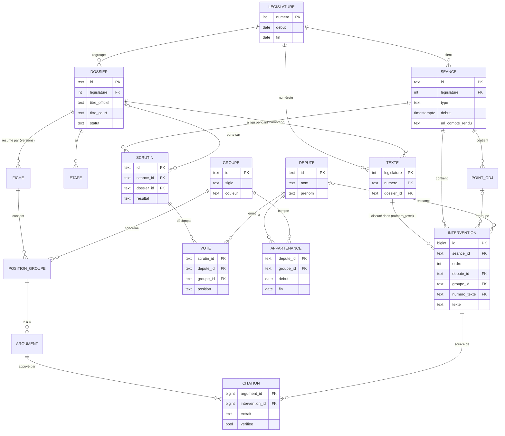

# Modèle de données

L'intervention est l'entité centrale : la recherche, la frise des débats et les citations des résumés pointent toutes vers elle.

*L'intervention est l'entité centrale. Le détail des champs est dans le dictionnaire de données.*

La liaison entre une loi et ses débats passe par le numéro du texte discuté : chaque intervention le porte, et la table texte, identifiée par le couple (législature, numéro), le relie au dossier. Le groupe d'un orateur se lit à la date de l'intervention via l'appartenance.

## Règles de conception

- **Identifiants de l'AN conservés** : chaque entité garde l'identifiant de l'open data (ex. PA… pour un député, PO… pour un organe), ce qui rend la collecte idempotente.
- **Le groupe est historisé** : un député peut changer de groupe ; l'intervention et le vote stockent le groupe à la date des faits.
- **Les orateurs non députés** (ministres, président de séance) sont des interventions sans député lié, avec un libellé et une qualité.
- **Les sorties IA sont versionnées** : une nouvelle fiche ne remplace pas l'ancienne, elle s'ajoute avec la version du modèle et du prompt.
- **Rien n'est supprimé** : les corrections de l'open data mettent à jour les lignes, avec une date de dernière mise à jour (`maj_le`).

## Entités hors schéma

| Entité | Rôle | Version |
| --- | --- | --- |
| Position de groupe, argument | Détail d'une fiche IA : un groupe, sa position, ses arguments ordonnés | V1 |
| Guide, terme du glossaire | Contenu de « Comprendre l'AN », lié aux termes des fiches | V1 |
| Run du pipeline | Historique des exécutions de nuit, statut, erreurs | V1 |
| Amendement | Auteur, groupe, article visé, sort, exposé sommaire | V1.1 |
| Indicateur de groupe | Participation, cohésion, proximité par période | V1.1 |
| Embedding d'intervention | Vecteur pour la recherche sémantique (pgvector) | V1.1 |
