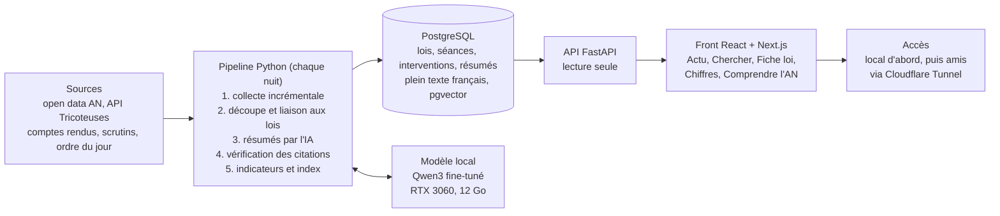

# Document d'architecture

Six composants tournent sur le PC : un pipeline de nuit, la base PostgreSQL dans laquelle il est seul à écrire, une API en lecture seule, un front, un modèle local et un tunnel optionnel vers l'extérieur.



*Tout tourne sur le PC. Le pipeline est le seul composant qui écrit en base.*

## Composants

| Composant | Responsabilité | Techno | Écrit en base |
| --- | --- | --- | --- |
| Pipeline | Collecter, découper, lier, résumer, vérifier, calculer les indicateurs | Python, tâche planifiée | Oui, seul écrivain |
| Base | Stocker les données parlementaires et les sorties IA, indexer | PostgreSQL + pgvector | — |
| API | Servir les données au front, recherche | FastAPI | Non, lecture seule (aucune route d'écriture, et un utilisateur PostgreSQL membre du rôle `lecture_seule`) |
| Front | Les 4 onglets, la fiche loi, la séance et le vote, mobile d'abord | React + Next.js (ADR-010) | Non |
| Modèle local | Résumer et classer sur demande du pipeline | Ollama ou llama.cpp sur la RTX 3060 | Non |
| Tunnel | Exposer l'appli sans ouvrir de port | Cloudflare Tunnel | Non |

## Déroulé du run de nuit

1. **Démarrage** (ex. 2 h) par le Planificateur de tâches ; un run qui a échoué la veille reprend les jours manqués.
2. **Collecte incrémentale** : téléchargement des jeux de données modifiés depuis le dernier run.
3. **Chargement** : insertion ou mise à jour par identifiant AN (idempotent).
4. **Découpage** des nouveaux comptes rendus en interventions, attribution du groupe à la date.
5. **Liaison** des interventions aux dossiers législatifs par le numéro du texte discuté ; celles qui restent non rattachées sont journalisées.
6. **Résumés IA** pour les lois ayant de nouveaux débats, nouvelle version de fiche.
7. **Vérification des citations** ; une fiche avec une citation non retrouvée est rejetée ou régénérée.
8. **Calculs** : score d'importance, index plein texte, indicateurs (composition et participation en V1, le reste en V1.1).
9. **Fin** : statut du run enregistré, alerte en cas d'échec.

## Exigences non fonctionnelles

| Exigence | Cible V1 |
| --- | --- |
| Temps de réponse d'une recherche | Moins de 500 ms pour 95 % des requêtes |
| Durée du run de nuit | Moins de 8 h en période budgétaire |
| Fraîcheur des données | J+1 après publication en open data |
| Disponibilité | Au mieux, tant que le PC est allumé |
| Données personnelles des visiteurs | Aucune stockée |
| Reproductibilité | Installation complète avec une commande (Docker Compose) |

## Structure du dépôt

```
/pipeline   collecte, découpage, liaison, run de nuit
/ml         dataset, entraînement, évaluation, prompts
/api        FastAPI, schémas, tests
/web        front
/db         migrations et schéma
/docs       dossier de cadrage, ADR, méthode
docker-compose.yml
```

## Déploiement

- **Docker Compose** lance la base, l'API et le front ; le modèle tourne directement sur Windows ou WSL2 pour accéder au GPU sans complexité.
- **Sauvegarde** : dump PostgreSQL hebdomadaire sur un second disque.
- **Migration future** : la même composition peut tourner sur un VPS ; seul le run de nuit (GPU) reste sur le PC et pousse en base à distance.
