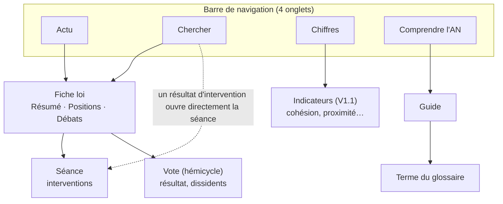

# Arborescence et navigation

Quatre onglets en barre de navigation (en bas sur téléphone, en haut sur ordinateur) : Actu · Chercher · Chiffres · Comprendre. La fiche loi n'est pas un onglet mais la page où mènent Actu et Chercher ; elle a ses propres onglets Résumé, Positions et Débats.

*Pied de page sur toutes les pages : Méthode · Statut des données · Mentions légales · Signaler une erreur.*

En pointillés : le raccourci de la recherche vers une séance. L'onglet Chiffres existe dès la V1 en version de base (composition, participation) et se complète en V1.1.

## Pages et adresses

| Page | Adresse | Contenu principal | Version |
| --- | --- | --- | --- |
| Actu | `/` | Agenda de la semaine, textes en cours, filtre de statut | V1 |
| Chercher | `/chercher?q=` | Barre unique, filtre Tout, Lois ou Propos | V1 |
| Fiche loi – Résumé | `/lois/{id}` | Avancement, résumé, ce qui fait débat, prochaine étape | V1 |
| Fiche loi – Positions | `/lois/{id}/positions` | Groupes rangés par position | V1 |
| Arguments d'un groupe | `/lois/{id}/positions/{groupe}` | Arguments, citations, liens vers les séances | V1 |
| Fiche loi – Débats | `/lois/{id}/debats` | Frise des séances publiques (commissions en V1.1) | V1 |
| Séance | `/seances/{id}` | Interventions dans l'ordre, filtre par groupe, recherche | V1 |
| Vote | `/scrutins/{id}` | Hémicycle, dissidents, vote par groupe | V1 |
| Comprendre | `/comprendre` | Guides, recherche dans le glossaire | V1 |
| Guide | `/comprendre/{slug}` | Un guide | V1 |
| Glossaire | `/comprendre/glossaire#{terme}` | Définitions courtes | V1 |
| Chiffres | `/chiffres` | Composition et participation en V1, autres indicateurs expliqués en V1.1 | V1 |
| Méthode, Statut, Mentions légales | `/methode`, `/statut`, `/mentions-legales` | Transparence et obligations légales | V1 |

## Règles de navigation

- **Toute page a une adresse partageable** : une fiche ou une séance peut être envoyée par lien.
- **Les filtres sont dans l'adresse** : une recherche filtrée se partage telle quelle.
- **Retour toujours possible** : depuis une séance, retour à la fiche loi qui y mène.
- **Termes techniques cliquables** sur les fiches, ouvrant la définition sans quitter la page.
- **Signaler une erreur** est accessible depuis chaque fiche et chaque citation.
