# Roadmap

Sans échéance fixe, la roadmap avance par phases ; on ne passe à la suivante que lorsque le critère de passage (losange) est rempli.

```mermaid
flowchart LR
    subgraph V1["Vers la V1"]
        P1["Cadrage<br/>dossier, ADR, wireframes"] --> G1{{"cadrage validé"}}
        G1 --> P2["Socle données<br/>jalons 1 à 3<br/>base, collecte, API, recherche"] --> G2{{"données liées aux lois"}}
        G2 --> P3["Version sans IA<br/>jalon 4<br/>Chercher, fiche loi, séances, hémicycle"] --> G3{{"utile sans IA"}}
        G3 --> P4["IA<br/>jalons 5 à 7<br/>référence, évaluation, fine-tuning"] --> G4{{"seuils d'évaluation atteints"}}
    end
    subgraph APRES["Après"]
        P5["V1 complète<br/>jalons 8 et 9<br/>Actu, guides, ouverture"] --> G5{{"ouverte aux amis"}}
        G5 --> P6["V1.1<br/>commissions, sémantique,<br/>ce que ça change"] --> P7["V2<br/>Sénat, lobbying, presse,<br/>discours vs vote"] --> P8["V3<br/>Parlement européen,<br/>rapports d'enquête"]
    end
    G4 --> P5
    style P3 stroke-width:3px
```

La phase « Version sans IA » est la plus importante : elle donne déjà un outil utile, et tout ce qui suit l'enrichit.

## Critères de passage

| Critère | Comment le vérifier |
| --- | --- |
| Cadrage validé | Les 18 documents relus, ADR-010 tranchée |
| Données liées aux lois | Pour les lois de la législature, la majorité des séances de débat est rattachée à leur dossier ; la recherche d'interventions répond en moins de 500 ms |
| Utile sans IA | Les parcours P2 et P4 réussis sur 5 lois réelles |
| Seuils d'évaluation atteints | Tous les seuils du protocole d'évaluation remplis par le modèle retenu |
| Ouverte aux amis | Run de nuit stable 2 semaines, pages légales et Méthode en ligne, tunnel sécurisé |

## Rythme indicatif

À quelques heures par semaine, compter de l'ordre de 2 à 3 mois par phase de la V1 ; c'est une estimation à réviser après la phase « Socle données », qui donnera la vraie vitesse.
